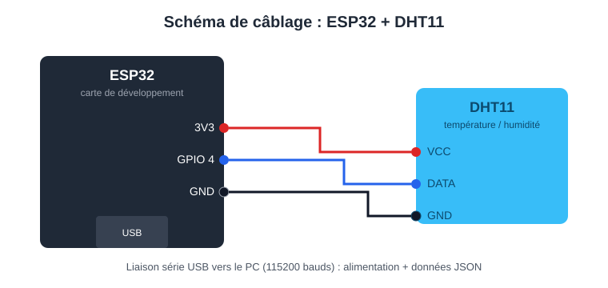
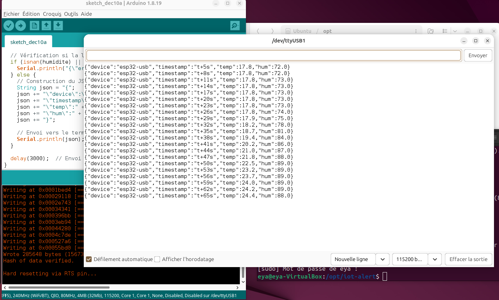
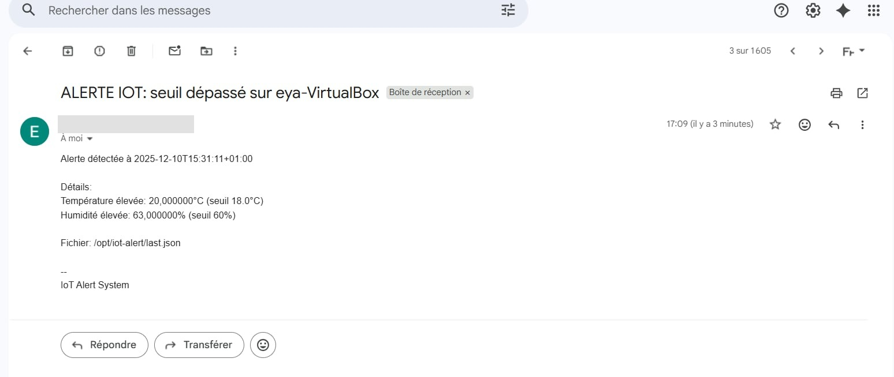

# IoT Alert – Surveillance température/humidité avec alerte e-mail

Système connecté de surveillance environnementale : un **ESP32** lit un capteur **DHT11**, envoie les mesures en JSON sur le port série USB, et une machine **Linux (Ubuntu)** compare les valeurs à des seuils puis envoie une **alerte par e-mail** (Bash + Postfix + SMTP Gmail).

Projet réalisé dans le cadre du module Linux (2026), tout en C/Arduino et Bash.

## Fonctionnement

```
DHT11 ──► ESP32 ──USB série (JSON)──► read.sh ──► last.json ──► alert.sh ──► Postfix ──► e-mail
```

1. **ESP32** : mesure toutes les 3 secondes et écrit une ligne JSON sur le port série (115200 bauds).
2. **`read.sh`** : lit le port série en continu et écrit la dernière ligne reçue dans `last.json`.
3. **`alert.sh`** : lit `last.json`, compare à `TEMP_MAX` et `HUM_MAX`, envoie un e-mail si un seuil est dépassé.
4. **Postfix** : relais SMTP via Gmail (voir [docs/postfix-gmail.md](docs/postfix-gmail.md)).

Format des données ([exemple](examples/last.example.json)) :
```json
{"device":"esp32-usb","timestamp":"t+473s","temp":17.1,"hum":74.0}
```

## Matériel

- Carte ESP32
- Capteur DHT11 : VCC sur **3V3**, GND sur **GND**, DATA sur **GPIO 4**
- Câble USB (alimentation + liaison série)

## Logiciel

- Arduino IDE 1.8.x avec le support ESP32 et la bibliothèque **DHT sensor library**
- Ubuntu avec `postfix`, `libsasl2-modules` et `mailutils` (commande `mail`)

## Installation

**1. Flasher l'ESP32** : ouvrir `firmware/esp32_dht11/esp32_dht11.ino`, choisir la carte et le port, téléverser. Le moniteur série (115200) doit afficher les lignes JSON.

**2. Copier les scripts sur la machine Linux :**
```bash
sudo mkdir -p /opt/iot-alert
sudo cp scripts/*.sh /opt/iot-alert/
sudo chmod +x /opt/iot-alert/*.sh
```

**3. Adapter la configuration :**
- `read.sh` : `SERIAL_PORT` (ex. `/dev/ttyUSB0` ou `/dev/ttyUSB1`)
- `alert.sh` : `TEMP_MAX`, `HUM_MAX`, `EMAIL_TO`

**4. Configurer Postfix** : suivre [docs/postfix-gmail.md](docs/postfix-gmail.md).

**5. Lancer :**
```bash
/opt/iot-alert/read.sh &                 # lecture série
watch -n 60 /opt/iot-alert/alert.sh      # vérification toutes les minutes
```
Pour automatiser la vérification, on peut utiliser `cron` (`* * * * * /opt/iot-alert/alert.sh`).

## Résultats

**Câblage :**



**Données reçues sur le port série :**



Alerte reçue par e-mail :




## Structure du dépôt

```
firmware/esp32_dht11/   code de l'ESP32 (Arduino C++)
scripts/                read.sh (lecture série), alert.sh (seuils + e-mail)
docs/                   configuration Postfix + captures
examples/               exemple de fichier de données
```

## Compétences mises en œuvre

C/C++ embarqué (ESP32), capteur DHT11, communication série UART, scripts Bash, Linux, Postfix/SMTP, format JSON.

## Pistes d'amélioration

- Utiliser `jq` pour lire le JSON plutôt que `grep`/`sed`
- Éviter les e-mails répétés à chaque cycle (délai minimum entre deux alertes)
- Lancer `read.sh` et `alert.sh` comme services `systemd`
- Passer en Wi-Fi/MQTT pour supprimer la liaison USB
